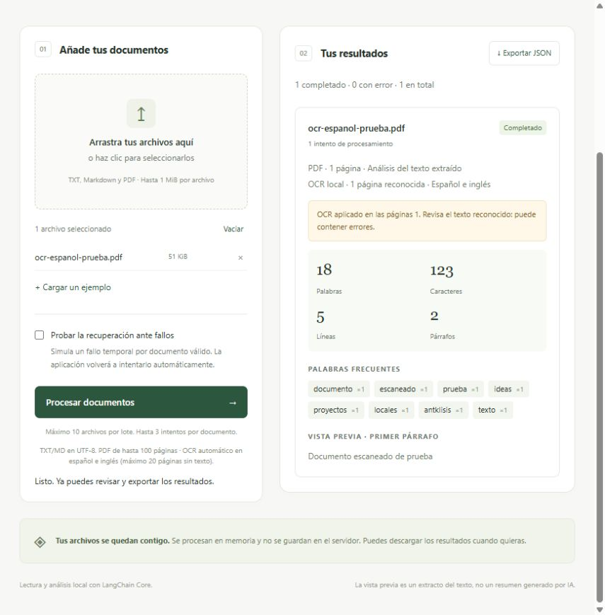

# Documento · Procesador local con LangChain Core

Aplicación en español para procesar archivos `.txt`, `.md` y PDF, incluidos escaneados, en tu ordenador. Funciona con Python y CPU, sin claves de API, cuentas externas ni servicios de pago.

**Versión 1.1.0 — aplicación local funcional.** LangChain Core compone el procesamiento y aplica reintentos; `pypdf` extrae texto y Tesseract reconoce páginas escaneadas. El resultado es un análisis determinista, sin un modelo de lenguaje externo.



## Empezar en Windows

Requiere Python 3.10 o posterior. Desde esta carpeta en PowerShell:

```powershell
python -m venv .venv
.venv\Scripts\python.exe -m pip install -r requirements-lock.txt
.venv\Scripts\python.exe app.py
```

Abre **http://127.0.0.1:8765**. Con el entorno instalado, también puedes hacer doble clic en `iniciar.cmd`. Mantén la terminal abierta mientras usas la aplicación; Ctrl+C detiene el servidor. Si el puerto está ocupado, usa `app.py --port 8766`.

En Linux, el equivalente al ejecutable del entorno es `.venv/bin/python`. Instala también Tesseract con los idiomas español e inglés según la sección de OCR.

## Demostración en cinco minutos

1. Arranca la aplicación, pulsa **Cargar un ejemplo** y después **Procesar documentos**. Revisa estadísticas y palabras frecuentes.
2. Activa **Probar la recuperación ante fallos** y procesa de nuevo. El ejemplo debe terminar correctamente en dos intentos.
3. Desactiva la simulación y añade un PDF con texto. El resultado debe indicar sus páginas y mostrar el extracto.
4. Añade un PDF escaneado legible. Las páginas reconocidas se indican como **OCR local**. Revisa posibles errores de reconocimiento.
5. Añade un TXT vacío al mismo lote: debe mostrar un error sin impedir los demás resultados. Descarga el JSON y comprueba que conserva resultados, avisos e intentos.

Los archivos de `ejemplos/` son sintéticos. Para una demostración de OCR utiliza un documento de prueba sin datos personales.

## Qué puedes hacer

- Arrastrar o seleccionar hasta 10 archivos TXT, Markdown o PDF, PDF de hasta 150 MiB y TXT/Markdown de hasta 1 MiB por archivo. TXT/Markdown deben estar en UTF-8.
- Extraer el texto de todas las páginas de un PDF (hasta 1000 páginas), con `pypdf`, desde una copia temporal local y sin conexiones externas. En páginas sin texto, aplicar OCR local automáticamente con PDFium y Tesseract en español e inglés, alemán e inglés o inglés, según el selector. Se indica qué páginas se han reconocido y cuáles siguen sin texto.
- Cargar un ejemplo incorporado o los documentos sintéticos de `ejemplos/`.
- Ver palabras, caracteres, líneas, párrafos y ocho palabras frecuentes, filtrando palabras comunes españolas, inglesas y alemanas.
- Leer una vista previa del primer párrafo, de hasta 500 caracteres. **Es un extracto, no un resumen ni una interpretación con IA.** Markdown se trata como texto; no se ejecuta ni renderiza HTML.
- Revisar errores por archivo sin perder los resultados de los otros documentos.
- Descargar el lote completo a JSON, incluidos los errores y el número de intentos.
- Activar «Probar la recuperación ante fallos»: simula un fallo temporal en el primer intento de cada archivo válido. El resultado debe mostrar 2 intentos. Está desactivada inicialmente.

Los PDF escaneados sin capa de texto pasan por OCR automáticamente. Los PDF mixtos conservan el texto digital y aplican OCR solo a las páginas sin texto, respetando su orden. El reconocimiento puede cometer errores: revisa nombres, cifras y texto poco legible. No se vuelve a reconocer una página que ya tenga texto extraíble. Los PDF cifrados se rechazan con una indicación para guardar una copia sin contraseña. También se detectan PDF dañados o archivos cuya extensión se cambió sin convertirlos.

El orden de lectura y la separación de párrafos dependen del texto extraído del PDF: tablas y columnas pueden perder su disposición visual. Las estadísticas se calculan sobre ese texto y el reconocido con OCR. El límite adicional es 5 millones de caracteres y 100 MiB de contenido de página descomprimido por PDF; si se supera, se pide dividir el documento. No incluye Word, traducción ni conexión con el recopilador de noticias.

Los archivos se procesan en segundo plano y la interfaz muestra subida y páginas procesadas. Puedes cancelar el lote. Mantén abierto el servidor hasta ver los resultados. Si recargas la misma pestaña, recupera el progreso y resultado del documento activo; los archivos aún no subidos y los resultados de documentos anteriores del lote no se recuperan. Los libros escaneados de cientos de páginas pueden tardar varios minutos. La cancelación espera a que termine la página OCR actual (hasta 20 segundos).

## OCR local

Además de instalar `requirements-lock.txt`, necesitas **Tesseract** con los idiomas `spa` y `eng` (y `deu` para alemán). En el ordenador de desarrollo ya está instalado y comprobado. Para otro equipo, consulta la [instalación de Tesseract](https://tesseract-ocr.github.io/tessdoc/Installation.html) e incluye español e inglés. Comprueba la instalación con:

```powershell
tesseract --list-langs
```

La aplicación busca `tesseract` en PATH y en `C:/Program Files/Tesseract-OCR/`. Para una ubicación distinta puedes definir `TESSERACT_CMD` antes de arrancarla. Si faltan el programa o los idiomas, verás instrucciones en el resultado; los PDF con texto digital siguen funcionando.

El OCR admite hasta **1000 páginas sin texto por PDF**, 20 segundos por página y un presupuesto de 7200 segundos por documento (además del tiempo de renderizado). Renderiza a unos 200 ppp, reduciendo la resolución si hace falta para limitar la imagen a 8 millones de píxeles. PDFium se usa bajo un bloqueo porque no admite llamadas concurrentes. Tesseract recibe las imágenes por la entrada estándar y devuelve texto por la salida estándar: no se escriben imágenes temporales ni se envía contenido a internet. No se genera un PDF nuevo con capa de texto; el resultado se muestra en la aplicación y se exporta a JSON.

## Cómo funciona

`processor.py` utiliza una cadena de `RunnableLambda` de LangChain Core: validación y lectura/extracción → análisis. Solo el análisis lleva `with_retry`; los formatos inválidos, archivos vacíos, binarios, errores de UTF-8, PDF no compatibles y tamaños excesivos se rechazan antes de ejecutarlo.

Los errores temporales (`TransientProcessingError` y errores de sistema EAGAIN, EBUSY, ETIMEDOUT y EINTR) tienen un máximo de **3 intentos en total**, con esperas cortas. Los errores permanentes no se reintentan. Cada archivo usa una cadena independiente para conservar correctamente los resultados de los lotes mixtos.

El análisis es determinista. LangChain Core aporta la composición y los reintentos. Versión probada: **1.6.9**, licencia MIT. `requirements-lock.txt` fija las dependencias del entorno validado en Windows/Python 3.10; `requirements.txt` declara la dependencia principal.

## Privacidad y funcionamiento local

El servidor escucha únicamente en `127.0.0.1`, exige origen local para procesar y solo sirve los tres recursos públicos de `web/`. Cada archivo se sube de forma binaria en bloques de 64 KiB y se guarda en una copia temporal local. Esa copia se elimina al terminar, fallar o cancelar; los resultados se mantienen en memoria durante hasta una hora (máximo 100 resultados anteriores). No se registra su contenido. Si el servidor se cierra durante un trabajo o se corta la alimentación, puede quedar una copia `documento-*` en la carpeta temporal del sistema; debe eliminarse manualmente. El navegador conserva los últimos resultados mientras la página siga abierta; solo la exportación crea un archivo descargado.

No se hacen peticiones externas al procesar. LangSmith viene como dependencia de LangChain Core, pero el proyecto desactiva su trazado. La instalación inicial sí requiere internet para descargar paquetes. Este servidor está diseñado para uso local.

## Comprobar la aplicación

```powershell
.venv\Scripts\python.exe -m unittest discover -s tests -v
```

Las pruebas cubren texto en español, métricas, UTF-8/BOM, límites, recuperación y agotamiento de reintentos, errores permanentes, PDF de varias páginas, escaneados, cifrados y dañados, OCR de páginas mixtas en orden, OCR ausente y tiempos límite, avisos de extracción parcial, lotes mixtos, exportación y servidor HTTP local. Los PDF de prueba se generan en memoria, sin documentos personales. La prueba real de OCR se omite si no está instalado Tesseract con español e inglés.

GitHub ejecuta las mismas comprobaciones al actualizar `main` o abrir una pull request. El workflow instala Tesseract y verifica explícitamente que español e inglés estén disponibles antes de ejecutar las pruebas, para que la integración real de OCR no quede omitida por falta de instalación.

## Estructura y decisiones

- `processor.py`: validación, extracción y cadena de procesamiento por archivo. La validación queda fuera de los reintentos.
- `ocr.py`: renderizado en memoria con PDFium y reconocimiento con Tesseract. Las llamadas a PDFium se serializan para evitar uso concurrente no admitido.
- `app.py`: servidor HTTP local, subida binaria, consulta de progreso y cancelación.
- `jobs.py`: cola local de hasta dos trabajos, un procesador simultáneo y limpieza de archivos temporales.
- `web/`: interfaz sin servicios externos, con resultados aislados por documento y descarga JSON.
- `tests/`: datos sintéticos y pruebas del dominio, del servidor y de integración con OCR.

Consulta los cambios entregados en `CHANGELOG.md`. Mejoras futuras como Word, resúmenes con IA, un PDF de salida con capa OCR o uso multiusuario quedan fuera de esta primera versión.

Comprobación manual: carga el ejemplo, procésalo, activa la simulación, vuelve a procesarlo y exporta JSON. Prueba también un TXT vacío para ver su error junto a los demás resultados.

## Referencias

- [LangChain Core](https://github.com/langchain-ai/langchain/tree/master/libs/core).
- [Runnable.with_retry](https://reference.langchain.com/python/langchain-core/runnables/base/Runnable/with_retry).
- [Extracción de texto con pypdf](https://pypdf.readthedocs.io/en/stable/user/extract-text.html).
- [Tesseract OCR](https://tesseract-ocr.github.io/tessdoc/Command-Line-Usage.html).
- [Noticia de origen: langchain-core 1.6.9](https://github.com/langchain-ai/langchain/releases/tag/langchain-core%3D%3D1.6.9).

No subas documentos personales, resultados privados, credenciales ni `.venv` al repositorio.
